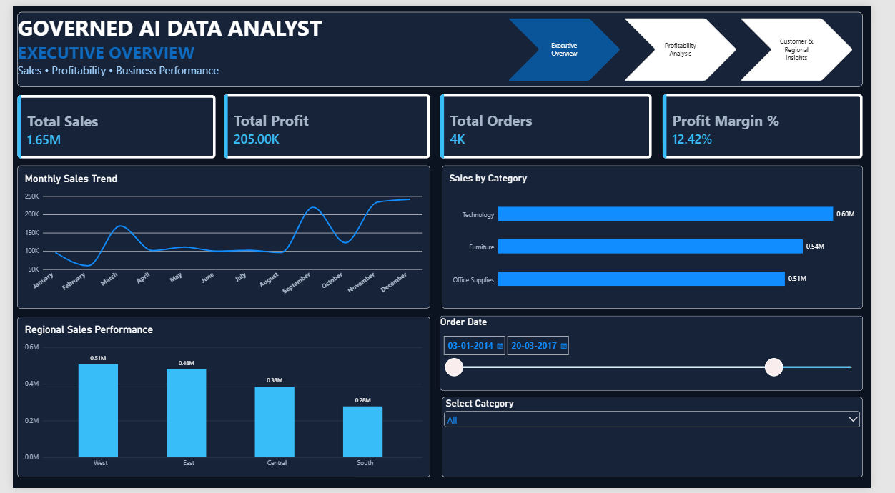

# 🤖 Governed AI Data Analyst Agent

### AI-Powered Business Intelligence | Python | MySQL | Power BI | Ollama

An AI-powered business analytics project designed to help users explore business data through natural-language questions while maintaining controlled database access and reliable analytical results.

## 📌 Project Overview

The Governed AI Data Analyst Agent combines traditional data analytics with Large Language Models (LLMs).

The project demonstrates how AI can support business analysis while following predefined rules, controlled data access, and KPI verification.

## 🎯 Project Objectives

- Enable natural-language business data analysis.
- Connect AI-assisted analytics with MySQL.
- Implement read-only database access.
- Reduce unsupported or fabricated AI-generated answers.
- Verify important business KPIs using Python.
- Present business insights through Power BI dashboards.

## 🏗️ Technology Stack

| Technology | Purpose |
|---|---|
| Python | Data analysis and KPI verification |
| MySQL | Database management |
| Ollama | Local LLM execution |
| Llama 3.2 (3B) | Language model |
| Power BI | Interactive dashboards |
| Jupyter Notebook | Development and analysis |
| Excel | Data handling and validation |

## 📊 Business Intelligence Dashboard

### 1. Executive Overview



### 2. Profitability Analysis


### 3. Customer & Regional Insights


## 📈 KPI Verification Results

The following metrics were verified using Python:

| KPI | Verified Result |
|---|---:|
| Total Sales | 2,297,200.86 |
| Total Profit | 286,397.02 |
| Total Orders | 5,009 |
| Profit Margin | 12.47% |

## 🔐 AI Governance & Data Controls

Key governance features demonstrated in this project:

- Read-only MySQL analyst account.
- Restricted business-analysis topics.
- Prompt-based response constraints.
- Data-summary-based answers.
- KPI verification using Python.
- Blocking unsupported analytical questions.

## 📂 Project Structure

```text
governed-ai-data-analyst-agent/
│
├── notebooks/
├── sql/
├── reports/
├── screenshots/
├── README.md
└── requirements.txt
```

## 🚀 Project Highlights

- Integrated Python, MySQL and local LLM technology.
- Developed a governed AI-assisted analytics workflow.
- Created a three-page Power BI dashboard.
- Verified business KPIs programmatically.
- Demonstrated controlled database access and AI response restrictions.

## 📚 Project Documentation

- [Jupyter Notebooks](notebooks/)
- [SQL Scripts](sql/)
- [Project Reports](reports/)
- [Dashboard Screenshots](screenshots/)

## 👨‍💻 Author

**Krunal Panchal**

B.Tech in Information Technology | Data Analytics | Generative AI | AI Agents

- GitHub: https://github.com/krunalpanchal-tech
- LinkedIn: Add your LinkedIn profile URL

---

⭐ If you find this project interesting, feel free to explore the repository and connect with me.

*Built as a practical portfolio project exploring the intersection of Business Intelligence, Data Analytics and Generative AI.*
